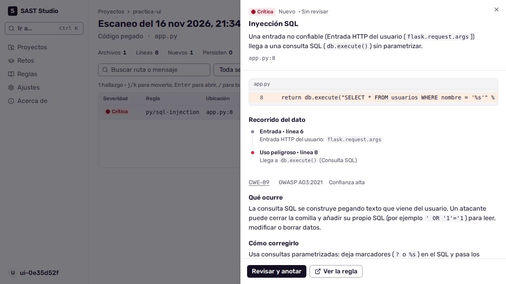
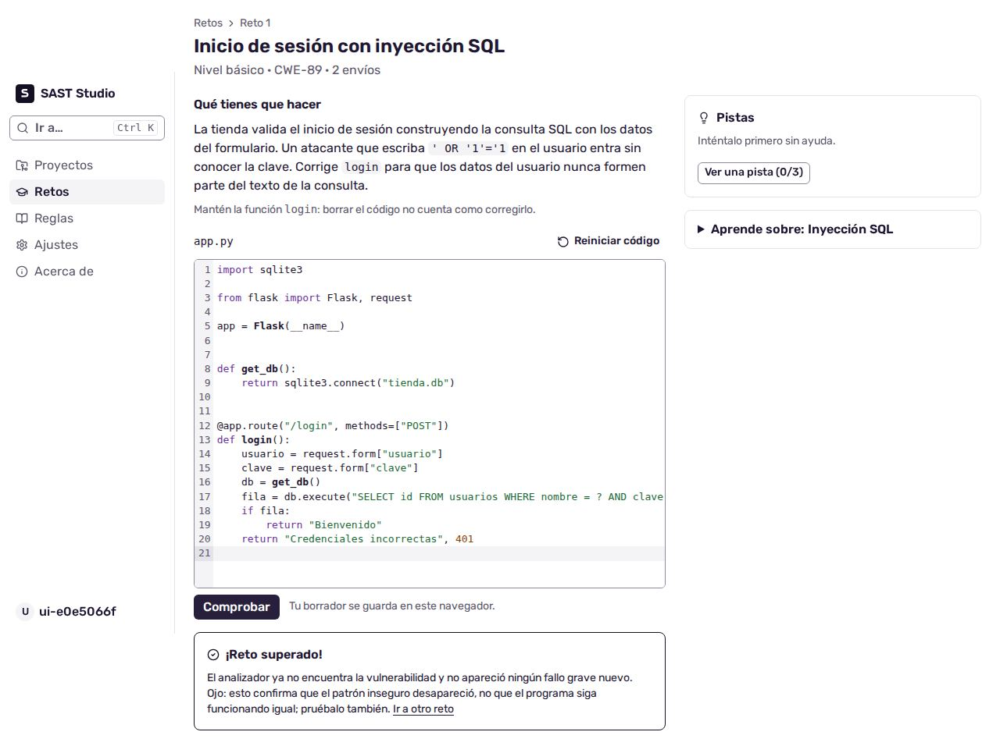
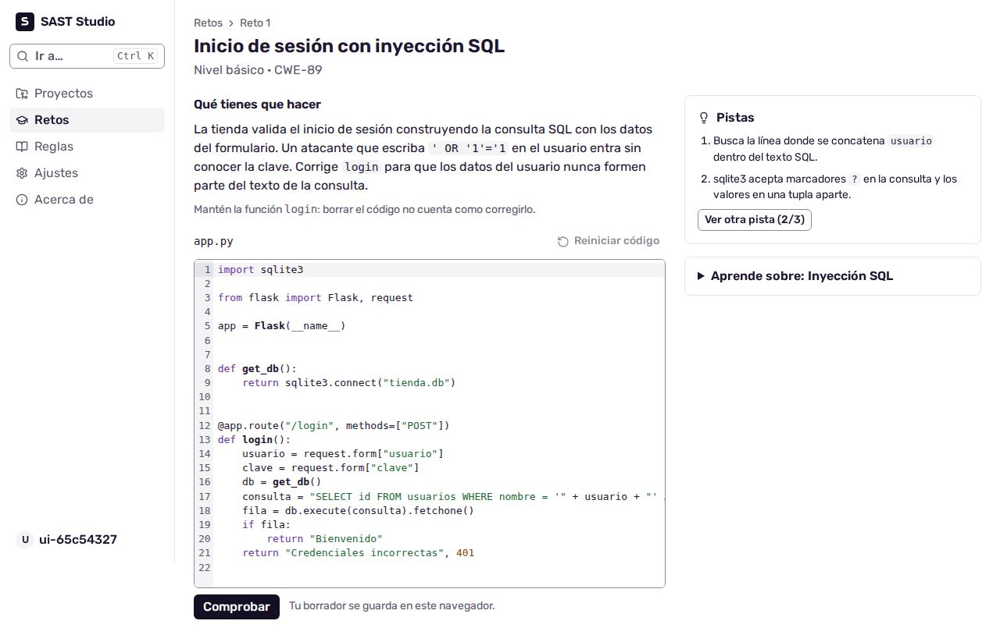
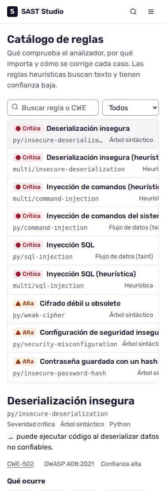

# Reporte 3 · Pruebas de interfaz de usuario

| | |
|---|---|
| **Proyecto** | SAST Studio |
| **Tipo de prueba** | Interfaz de usuario (de extremo a extremo en el navegador) |
| **Herramientas** | Playwright 1.65 con Chromium, pytest-playwright 0.10, pytest-html 4 |
| **Automatización** | Job `3 · Interfaz de usuario` de `.github/workflows/pruebas.yml` |
| **Fecha del run** | 16 de noviembre de 2026 |
| **Resultado** | ✅ 7 de 7 pasan |

## 1. Objetivo

Comprobar que un usuario puede usar SAST Studio **en un navegador real**: escribir, hacer clic,
ver resultados y leer mensajes, en las pantallas reales de la aplicación compilada.

Además de las 30 pruebas de componentes de la web con Vitest (que comprueban cada pantalla por
separado y sin navegador), estas pruebas recorren la aplicación completa: navegador → web →
API → worker → base de datos.

## 2. Cómo funcionan

1. Se compila la web (`npm run build`).
2. `scripts/servidor_pruebas.py` arranca el servidor completo con una base de datos vacía.
3. Playwright abre Chromium sin ventana y sigue los pasos de cada prueba.
4. Los elementos se buscan **como los ve el usuario**: por su rol y su texto («el botón
   *Comprobar*», «el campo *Correo*»), no por detalles internos del código. Así las pruebas
   también vigilan la accesibilidad: si un botón pierde su nombre, la prueba falla.
5. Al terminar cada prueba se guarda una captura de pantalla en el reporte HTML, y si falla, otra
   en `fallos/`.

## 3. Casos de prueba

| # | Prueba | Pasos | Resultado esperado |
|---|---|---|---|
| 1 | Inicio sin correo | Abrir `/login`; escribir un correo sin `@`; luego uno válido | «Entrar» desactivado hasta que el correo es válido |
| 2 | Sin sesión | Abrir `/proyectos` sin haber entrado | Redirige a `/login` |
| 3 | Escanear y leer el hallazgo | Entrar → «Nuevo proyecto» → pegar código vulnerable en el editor → «Lanzar escaneo» → abrir el hallazgo | Aparece `py/sql-injection` como **Crítica**; el panel muestra «Qué ocurre», «Cómo corregirlo» y CWE-89 |
| 4 | Resolver un reto | «Retos» → «Superados 0 de 8» → reto 1 → «Comprobar» sin cambios → pegar la corrección → «Comprobar» | Primero «La vulnerabilidad sigue presente», después «¡Reto superado!» |
| 5 | Pistas de una en una | Abrir el reto 1 → «Ver una pista» → «Ver otra pista» | 0, luego 1, luego 2 pistas visibles |
| 6 | Catálogo de reglas | «Reglas» | Título «Catálogo de reglas» y la regla `py/sql-injection` |
| 7 | Uso en el móvil | Pantalla de 375 px; visitar Proyectos, Retos y Reglas | Ninguna página se desborda a lo ancho |

## 4. Resultados

| Pruebas | Pasan | Fallan | Tiempo |
|---:|---:|---:|---:|
| 7 | 7 | 0 | 16,0 s |

## 5. Evidencias (capturas del run)

**Caso 3:** el hallazgo de inyección SQL explicado, con el recorrido del dato.

**Caso 4:** el reto superado tras corregir la consulta en el editor del navegador.

**Caso 5:** las pistas se revelan de una en una.

**Caso 7:** la página de retos en un móvil de 375 px, sin desplazamiento horizontal.

El resto de capturas está en `3-interfaz/interfaz.html`, dentro del artefacto
`reportes-de-pruebas`.

## 6. Incidencias encontradas al escribir las pruebas

Los primeros intentos fallaron por suposiciones sobre la interfaz, no por errores de la
aplicación:

- La fila de un hallazgo se abre con clic en la fila, no con un enlace.
- Al crear un proyecto, la web lleva directamente a «Nuevo escaneo».
- Las pistas muestran el código con formato, sin las comillas invertidas del texto original.

Las pruebas se ajustaron para seguir el comportamiento real que ve el usuario.

## 7. Conclusiones

- Los recorridos principales funcionan en un navegador real: entrar, escanear, entender un
  hallazgo y resolver un reto.
- La aplicación es usable en un móvil sin desplazamiento horizontal.
- Al buscar los elementos por su rol y nombre, las pruebas comprueban también que los controles
  son accesibles.
